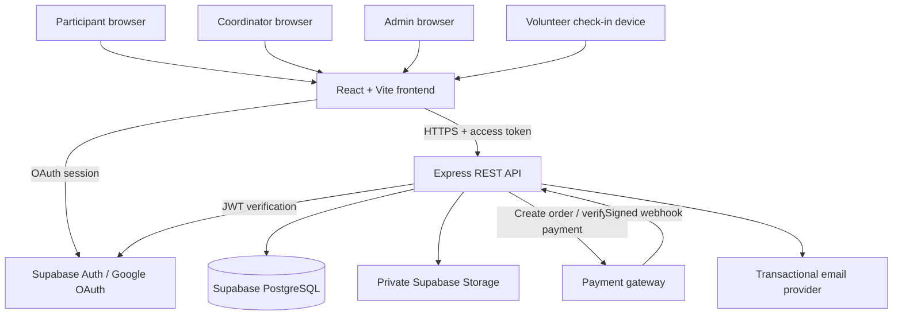
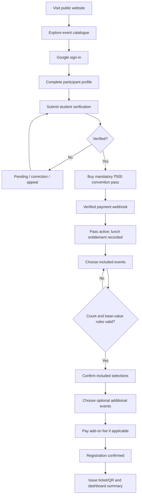

# Parallax — Reusable Convention Platform Architecture & Implementation Runbook

> **Purpose:** A practical, maintainable blueprint for turning the GitHub Pages frontend prototype into a secure, reusable, full-stack convention platform. This document is intended to be imported into an Obsidian vault and followed as a project runbook.

## 0. Executive recommendation

Build Parallax as a **multi-edition convention management platform**, not a one-off event website.

A future convention should be created by adding a new `convention_editions` record and configuring its branding, dates, venue, pass price, complimentary event-selection policy, event catalogue, coordinators, and registration windows. The same application, API, database and dashboards should serve every edition.

Recommended target architecture:

- **Frontend:** React + Vite + React Router + Tailwind CSS.
- **Backend:** Node.js + Express REST API.
- **Authentication:** Supabase Auth with Google OAuth.
- **Database:** Supabase-hosted PostgreSQL.
- **File storage:** Supabase Storage with private buckets for verification documents.
- **Payments:** An India-capable payment gateway (for example, Razorpay), created and verified only by the backend.
- **Static prototype hosting:** GitHub Pages.
- **Production frontend hosting:** Cloudflare Pages or another static hosting provider.
- **Production API:** Always-on Node hosting; do not depend on a free service that sleeps during registrations.
- **Email:** Optional transactional provider, sending from an authorized ISTE/college domain once DNS and sender authorization are approved.

The ₹1,000 operating ceiling is a planning target, not a guarantee. A genuinely reliable zero-downtime API, production database backups, a custom domain and gateway charges may exceed it. Use free services for development and preview; obtain institutional approval for any production upgrade before collecting money.

---

# Part I — Product and business model

## 1. Product vision

Parallax is the current edition of a reusable platform for ISTE student conventions. It has four primary audiences:

1. Public visitors exploring the convention.
2. Verified student participants.
3. Convention administrators and finance/verification staff.
4. Event coordinators and check-in volunteers.

The platform must support:

- Public event discovery.
- Google sign-in.
- Student eligibility verification.
- A mandatory convention pass.
- Included complimentary event choices subject to a value cap.
- Additional paid event registrations.
- Individual and team event formats.
- Payment reconciliation.
- Coordinator-scoped dashboards.
- QR tickets and attendance.
- Announcements, schedules, certificates and reports.
- Reuse for future convention editions with data/configuration changes rather than code changes.

## 2. Confirmed planning inputs

| Item | Current planning value | Status |
|---|---|---|
| Convention | Parallax | Current edition name |
| Organizer | ISTE | Confirm official organization/branch naming and permissions |
| Official email | An ISTE official email ID exists | Exact address and sending authorization pending |
| Host | NSS College of Engineering, Palakkad | Current edition |
| Audience | Approximately 500–1,000 participants; wider design target 500–1,500 | Planning estimate |
| Common pass | ₹500 per participant | Current proposal; obtain written approval |
| Lunch | Lunch on both convention days included in the ₹500 pass | Current proposal; clarify dietary/meal entitlement operationally |
| Complimentary event choices | Three or four events | Exact rule pending |
| Included-event value cap | ₹400 or ₹450 range | Final amount pending |
| Additional events | Can be purchased individually after mandatory pass | Current proposal; define exact eligibility and fee treatment |
| Event types | Individual and team | Required |
| Eligibility | Student eligibility must be verified | Verification method pending |
| Email confirmation | Optional | Must not be sole proof of registration/payment |
| Technology | React + Vite + Express + Supabase/PostgreSQL | Preferred |
| Initial frontend | Static GitHub Pages prototype | First deliverable |
| Operating budget | Less than ₹1,000 if feasible | Target, subject to production reliability and gateway costs |

## 3. Mandatory convention-pass pricing model

### 3.1 The business rule in plain language

Every attendee must purchase a **₹500 Parallax Convention Pass**. The pass includes lunch on both convention days and grants access to a configured number of eligible complimentary event selections. The sum of the selected events' configured base values must not exceed the edition's included-event value cap.

A participant may choose additional events individually at their separately published add-on price, but the mandatory convention pass is still required. Buying individual event entries does not replace the pass.

For team events, the recommended default is that **every team member must hold a valid convention pass**, while one team registration represents the team's entry into that particular event. The team leader can coordinate payment for the event entry, but that does not pay the convention-pass fee for the other members.

### 3.2 Do not confuse these amounts

| Concept | Meaning | Example only |
|---|---|---:|
| `pass_price` | Mandatory per-person convention access pass | ₹500 |
| `base_value` | Event value used to determine whether it qualifies for the complimentary selection allowance | ₹100 |
| `included_event_value_cap` | Maximum sum of selected events' `base_value` | ₹450 (illustrative only) |
| `included_event_count` | Number of complimentary selections allowed | 3 or 4 |
| `addon_price` | Amount payable to add this event separately after the pass | ₹150 |
| `team_event_fee` | Event entry fee for a team, if applicable | Per event configuration |

The convention pass is **not** a wallet or discount balance. The cap applies to the sum of event base values, not to the ₹500 pass and not automatically to add-on charges.

### 3.3 Illustrative calculation — not approved prices

Suppose the approved configuration later becomes:

- Pass price = ₹500.
- Lunch included = both days.
- Included selections = exactly 4.
- Included base-value cap = ₹450.

A participant selects events with base values ₹100, ₹100, ₹125 and ₹125. Their sum is ₹450, so it fits the cap and the participant still pays the mandatory ₹500 pass.

A fifth event is an add-on and is charged at its configured `addon_price`; it does not become free merely because the participant has not exhausted the rupee cap. The add-on does not replace the convention pass.

If selected event base values sum to ₹475, the included selection is invalid even if the count is within four. The participant must choose another eligible event or pay for an additional event under the approved add-on rules.

### 3.4 Configuration must support policy alternatives

Do not hard-code the present uncertainty. The edition needs these configurable values:

```json
{
  "currency": "INR",
  "passPricePaise": 50000,
  "lunchIncludedDays": 2,
  "includedEventCount": 4,
  "includedSelectionMode": "exact",
  "includedEventValueCapPaise": 45000,
  "includedValueBasis": "base_value",
  "additionalEventPurchaseRequiresPass": true,
  "teamMembersRequireIndividualPass": true
}
```

The example is illustrative. `includedEventCount`, `includedSelectionMode` and `includedEventValueCapPaise` must be approved before production. Use integer paise in payment calculations (`₹1 = 100 paise`) to avoid floating-point rounding issues.

Possible selection modes:

- `exact`: participant must choose exactly N included events before confirming.
- `up_to`: participant may choose any number from zero through N.
- Do not use `at_least` unless explicitly required.

### 3.5 Team event policy

Recommended default:

- A team must meet the event's minimum and maximum member count.
- Every team member must have a verified student profile.
- Every team member must have a paid/valid ₹500 pass for that edition.
- The team's event registration is created once.
- Any team-specific add-on/event fee is charged once per team unless the event configuration explicitly says per participant.
- Team member changes after payment need a controlled policy and audit trail.

Faculty must approve whether team event fees are per team or per member, and whether each member's complimentary selection allowance applies independently to that team event.

## 4. Questions requiring approval before payment implementation

Record decisions in `docs/DECISIONS.md` or this Obsidian note.

- [ ] Is the included-event count exactly 3 or exactly 4, or may participants choose up to that number?
- [ ] Is the included-event value cap ₹400 or ₹450? Is it inclusive (`<=`) of the cap?
- [ ] Is `base_value` the public individual fee, an organizer-assigned notional value, or a special value for the bundle?
- [ ] Are all events eligible for inclusion, or are some excluded (workshops, limited-capacity events, premium events, etc.)?
- [ ] Can a participant select events with different event dates/times? What prevents schedule conflicts?
- [ ] Are add-on events charged per participant or per team?
- [ ] Must every team member individually pay the convention pass? Recommended: yes.
- [ ] Does the pass cover lunch for both days regardless of whether the participant attends both days? How are meal counts communicated to caterers?
- [ ] Are refunds allowed for the pass? For event add-ons? What if an event is cancelled?
- [ ] Can the participant change included-event selections after checkout? Until what deadline?
- [ ] Is a pass transferable? Recommended: no, unless an admin records a formal change.
- [ ] What student documents are accepted, who verifies them, and how long are documents retained?
- [ ] Does eligibility require any valid student status, institution nomination, or ISTE membership?
- [ ] Is payment collected by the ISTE body, college, or another registered entity? Who owns gateway KYC, settlement and refunds?
- [ ] What exact official ISTE email address may be shown publicly and may send automated emails?
- [ ] Which edition dates, venue rooms and timetable are confirmed?
- [ ] What is the approved cancellation, dispute and support process?

Do not silently decide these points in code.

---

# Part II — Reusable platform architecture

## 5. Multi-edition architecture principle

The key to reuse is to make **Convention Edition** the top-level tenant/business object.

The system should not assume that:

- every convention costs ₹500;
- every convention lasts two days;
- every convention uses the same event count or value cap;
- the host is always NSS College of Engineering;
- the same event categories or coordinators apply;
- the same registration, refund or eligibility policy applies.

All edition-specific values must live in the database and be editable through an authorized management interface.

### 5.1 Edition configuration

Each edition should have:

- Unique slug and display name.
- Organizer and host organization.
- Host venue and timezone.
- Start/end dates and number of days.
- Branding theme and logo assets.
- Official contact email and support details.
- Registration opening/closing time.
- Participant capacity and event capacity rules.
- Student eligibility policy.
- Mandatory pass price and benefits.
- Included event count, selection mode and value cap.
- Add-on rules.
- Team policy.
- Payment gateway configuration reference (secrets remain in environment/secret manager).
- Terms, cancellation and refund policy versions.
- Publication state: draft, published, registration_open, registration_closed, completed, archived.

### 5.2 Multi-edition lifecycle

1. Super admin creates a new edition.
2. Admin selects a theme/branding preset.
3. Admin configures dates, location and contact information.
4. Admin sets eligibility, pass and included-event rules.
5. Admin imports or creates events.
6. Admin assigns coordinators and verifier/finance staff.
7. Admin previews the public pages.
8. Admin tests registration and payment in sandbox mode.
9. Admin publishes the edition and opens registration.
10. At the end, admin closes registration, completes attendance/results/certificates, reconciles payments and archives the edition.

A future convention should be created through this workflow, not by editing React component source.

## 6. System context diagram



### 6.1 Trust boundaries

- Browser is untrusted. Never accept a browser-calculated price, role, payment state, event capacity or eligibility status as authoritative.
- Express is the trusted business-logic boundary.
- Supabase service-role credentials exist only in backend secret storage.
- Payment gateway secret and webhook secret exist only in backend secret storage.
- Verification documents are private; never expose public bucket URLs.
- Payment webhook is an external input and must be signature-verified, idempotent and schema-validated.

## 7. Repository architecture

Recommended monorepo:

```text
parallax-platform/
├── apps/
│   ├── web/                    # React + Vite frontend
│   └── api/                    # Express REST API
├── packages/
│   └── shared/                 # Shared schemas/constants if useful
├── supabase/
│   ├── migrations/             # Versioned SQL migrations
│   ├── seed/                   # Local/demo seed data
│   └── config.toml             # Supabase local configuration if used
├── docs/
│   ├── architecture/
│   ├── decisions/
│   ├── operations/
│   └── api/
├── scripts/
├── .github/workflows/
├── .env.example
├── .gitignore
├── package.json                # Workspace scripts if using npm workspaces
└── README.md
```

For the initial GitHub Pages prototype, the repository may start with only `frontend/` or `apps/web/`. Preserve the public pages and service interfaces when adding `apps/api/` and database migrations later.

### Frontend modules

```text
src/
├── app/
│   ├── router/
│   ├── providers/
│   └── layouts/
├── components/
│   ├── common/
│   ├── forms/
│   ├── events/
│   ├── pass-selection/
│   ├── teams/
│   └── dashboards/
├── features/
│   ├── public-site/
│   ├── authentication/
│   ├── participant/
│   ├── verification/
│   ├── convention-pass/
│   ├── registrations/
│   ├── payments/
│   ├── management/
│   └── check-in/
├── services/                  # API adapter boundary
├── config/
├── hooks/
├── utils/
└── styles/
```

### Backend modules

```text
src/
├── app.js
├── server.js
├── config/
├── middleware/
│   ├── authenticate.js
│   ├── authorize.js
│   ├── validate.js
│   ├── rateLimit.js
│   └── errorHandler.js
├── modules/
│   ├── editions/
│   ├── users/
│   ├── roles/
│   ├── verification/
│   ├── events/
│   ├── teams/
│   ├── passes/
│   ├── registrations/
│   ├── payments/
│   ├── tickets/
│   ├── attendance/
│   ├── announcements/
│   ├── certificates/
│   ├── reports/
│   └── audit/
├── integrations/
│   ├── supabase/
│   ├── payment-gateway/
│   └── email/
├── jobs/
├── db/
└── tests/
```

Keep domain logic in services/use-cases, not inside route handlers. Route handlers should validate, call a service, and format the response.

---

# Part III — Database design

## 8. Database conventions

Use PostgreSQL. Recommended conventions:

- UUID primary keys (`gen_random_uuid()`).
- `timestamptz` for all timestamps; store UTC, display in `Asia/Kolkata` for this convention.
- INR money as integer paise (`bigint`) for payment arithmetic.
- Foreign keys and check constraints for invariants.
- `created_at` and `updated_at` on mutable business records.
- Soft archive for editions/events where historical records must remain.
- Versioned migrations; do not edit a migration already applied to a shared/production database.
- Explicitly scope edition-specific records by `edition_id`.
- Never store payment card/UPI credentials.

## 9. Proposed schema catalogue

This is a logical schema. Implement it through reviewed, ordered SQL migrations; do not paste all tables into one unreviewed production migration.

### 9.1 Identity and access

#### `profiles`

| Column | Type | Notes |
|---|---|---|
| `id` | uuid PK | Same value as Supabase Auth user ID |
| `full_name` | text | Required for registration |
| `email` | citext/text | Keep verified email from Auth; unique as appropriate |
| `phone_e164` | text | Validate and collect only if necessary |
| `created_at` | timestamptz | |
| `updated_at` | timestamptz | |

Do not place a user-editable role field here.

#### `user_roles`

| Column | Type | Notes |
|---|---|---|
| `id` | uuid PK | |
| `user_id` | uuid FK profiles | |
| `role` | enum/text | `super_admin`, `admin`, `finance_admin`, `verifier`, `coordinator`, `checkin_staff`, `participant` |
| `assigned_by` | uuid FK profiles | |
| `created_at` | timestamptz | |

Avoid a single mutable `profiles.role`. A user can hold more than one role; global and edition-scoped access should be represented separately.

#### `edition_memberships`

| Column | Type | Notes |
|---|---|---|
| `id` | uuid PK | |
| `edition_id` | uuid FK | |
| `user_id` | uuid FK | |
| `role` | text/enum | Admin, verifier, finance admin, coordinator, check-in staff, participant |
| `status` | text | active/revoked |
| `assigned_by` | uuid FK | |

Use this to avoid accidentally granting a coordinator access to every edition.

### 9.2 Convention editions

#### `convention_editions`

| Column | Type | Notes |
|---|---|---|
| `id` | uuid PK | |
| `slug` | text unique | e.g. `parallax-2026` (edition identifier is a decision) |
| `name` | text | Public title |
| `organizer_name` | text | ISTE or authorized organizer |
| `host_name` | text | Host institution |
| `venue_name` | text | |
| `city` | text | |
| `timezone` | text | Default `Asia/Kolkata` |
| `starts_at` | timestamptz | Nullable until confirmed |
| `ends_at` | timestamptz | |
| `registration_opens_at` | timestamptz | |
| `registration_closes_at` | timestamptz | |
| `status` | enum | draft/published/open/closed/completed/archived |
| `branding` | jsonb | Logo references, colors, font choices |
| `contact_email` | text | Approved official address |
| `created_at` | timestamptz | |
| `updated_at` | timestamptz | |

#### `edition_policies`

One policy record per edition, optionally versioned.

| Column | Type | Notes |
|---|---|---|
| `id` | uuid PK | |
| `edition_id` | uuid FK unique/current | |
| `currency` | char(3) | `INR` |
| `pass_price_paise` | bigint | 50000 for ₹500 |
| `lunch_included_days` | smallint | 2 for current proposal |
| `included_event_count` | smallint | 3 or 4; pending approval |
| `included_selection_mode` | text | exact/up_to |
| `included_value_cap_paise` | bigint | 40000 or 45000 candidate; pending approval |
| `included_value_basis` | text | `base_value` |
| `additional_event_requires_pass` | boolean | true |
| `team_members_require_pass` | boolean | recommended true |
| `eligibility_policy` | jsonb | Documents/domains/review policy reference |
| `refund_policy_version` | text | Versioned terms reference |
| `effective_from` | timestamptz | |

If policies can change after registration begins, do not overwrite the policy used for existing orders. Snapshot the relevant policy version and prices into the registration/pass records.

### 9.3 Participants and student verification

#### `participant_profiles`

| Column | Type | Notes |
|---|---|---|
| `id` | uuid PK/FK profiles | |
| `college_name` | text | |
| `university_name` | text | Optional |
| `course` | text | |
| `branch` | text | |
| `year_of_study` | smallint | |
| `student_identifier` | text | Only if required; protect access |
| `institutional_email` | text | Optional verification path |

#### `eligibility_verifications`

| Column | Type | Notes |
|---|---|---|
| `id` | uuid PK | |
| `edition_id` | uuid FK | Eligibility may vary per edition |
| `user_id` | uuid FK | |
| `method` | text | college email, college ID, manual list, etc. |
| `status` | text | pending/verified/rejected/expired |
| `reviewer_id` | uuid FK nullable | |
| `document_object_path` | text nullable | Private storage object path, not a public URL |
| `review_notes` | text | Keep minimal; avoid sensitive details |
| `submitted_at` | timestamptz | |
| `reviewed_at` | timestamptz | |
| `expires_at` | timestamptz nullable | |

Use a private bucket, signed short-lived retrieval links, least-privilege access and a documented deletion schedule. Prefer institutional-email or registrar-list verification over retaining ID card images where practical.

### 9.4 Events and coordinators

#### `event_categories`

| Column | Type | Notes |
|---|---|---|
| `id` | uuid PK | |
| `edition_id` | uuid FK | Categories can differ by edition |
| `name` | text | |
| `slug` | text | |
| `display_order` | integer | |

#### `events`

| Column | Type | Notes |
|---|---|---|
| `id` | uuid PK | |
| `edition_id` | uuid FK | Required |
| `category_id` | uuid FK | |
| `slug` | text | Unique within edition |
| `title` | text | |
| `summary` | text | |
| `description` | text | |
| `rules` | jsonb/text | Structured or rich text with safe rendering |
| `format` | text | individual/team |
| `team_min_size` | smallint | Validate for team event |
| `team_max_size` | smallint | Validate for team event |
| `base_value_paise` | bigint | Used only for included-event cap calculation |
| `addon_price_paise` | bigint | Additional separate fee; do not infer from base value |
| `addon_charge_basis` | text | per_participant/per_team |
| `included_eligible` | boolean | Event may be excluded from complimentary selection |
| `capacity` | integer nullable | Define unit: individuals or entries |
| `registration_opens_at` | timestamptz | |
| `registration_closes_at` | timestamptz | |
| `starts_at` | timestamptz nullable | |
| `ends_at` | timestamptz nullable | |
| `venue` | text | |
| `status` | text | draft/published/open/closed/cancelled |
| `sort_order` | integer | |

#### `event_coordinator_assignments`

| Column | Type | Notes |
|---|---|---|
| `id` | uuid PK | |
| `event_id` | uuid FK | |
| `user_id` | uuid FK | Coordinator |
| `permission_scope` | jsonb/text | e.g. view, approve, attendance, results |
| `assigned_by` | uuid FK | |
| `created_at` | timestamptz | |

### 9.5 Convention pass and event selection

#### `convention_passes`

One per participant per edition.

| Column | Type | Notes |
|---|---|---|
| `id` | uuid PK | |
| `edition_id` | uuid FK | |
| `participant_id` | uuid FK | |
| `policy_version` | text/uuid | Policy snapshot/version |
| `price_paise` | bigint | Price charged, immutable snapshot |
| `status` | text | pending_payment/active/refund_pending/refunded/revoked/expired |
| `lunch_entitlement_days` | smallint | Snapshot of included days |
| `paid_at` | timestamptz nullable | |
| `valid_from` | timestamptz | |
| `valid_until` | timestamptz | |
| `created_at` | timestamptz | |

Add a unique constraint on `(edition_id, participant_id)` if only one pass is allowed per participant per edition. Model replacements/refunds explicitly rather than silently creating duplicates.

#### `included_event_selections`

| Column | Type | Notes |
|---|---|---|
| `id` | uuid PK | |
| `edition_id` | uuid FK | |
| `pass_id` | uuid FK | |
| `event_id` | uuid FK | |
| `base_value_paise_snapshot` | bigint | Immutable value used at selection time |
| `status` | text | selected/confirmed/removed/locked |
| `selected_at` | timestamptz | |

Constraints:

- Unique `(pass_id, event_id)`.
- The event and pass must belong to the same edition (enforce through composite keys or a trusted transactional service).
- Count and sum caps must be validated transactionally, not by a frontend check alone.
- Re-check eligibility and event availability when selection is finalized.

#### `registrations`

Represents either an individual event entry or a team event entry.

| Column | Type | Notes |
|---|---|---|
| `id` | uuid PK | |
| `edition_id` | uuid FK | |
| `event_id` | uuid FK | |
| `registration_number` | text unique | Human-readable public reference; non-secret |
| `participant_id` | uuid nullable FK | Set for an individual entry |
| `team_id` | uuid nullable FK | Set for a team entry |
| `registration_kind` | text | individual/team |
| `fee_paise_snapshot` | bigint | Fee payable for this registration, if any |
| `status` | text | pending_payment/pending_approval/confirmed/cancelled/rejected/expired |
| `created_at` | timestamptz | |
| `confirmed_at` | timestamptz nullable | |

Check constraint: exactly one of `participant_id` and `team_id` must be non-null. Additional unique constraints prevent duplicate individual/event or team/event registration.

#### `teams`

| Column | Type | Notes |
|---|---|---|
| `id` | uuid PK | |
| `edition_id` | uuid FK | |
| `name` | text | |
| `invite_code_hash` | text | Store hash, not raw invite token |
| `leader_id` | uuid FK | |
| `status` | text | forming/ready/locked/disbanded |
| `created_at` | timestamptz | |

#### `team_members`

| Column | Type | Notes |
|---|---|---|
| `id` | uuid PK | |
| `team_id` | uuid FK | |
| `user_id` | uuid FK | |
| `status` | text | invited/joined/removed |
| `joined_at` | timestamptz nullable | |

Unique `(team_id, user_id)`. Validate that member count and pass/verification state meet the event's rules when the team registration is submitted and again when locked.

### 9.6 Payments and reconciliation

#### `payment_orders`

| Column | Type | Notes |
|---|---|---|
| `id` | uuid PK | Internal ID |
| `edition_id` | uuid FK | |
| `participant_id` | uuid FK | Payer/account owner |
| `purpose` | text | convention_pass/event_addon/team_entry |
| `purpose_record_id` | uuid | Reference; validate server-side |
| `gateway` | text | |
| `gateway_order_id` | text unique | |
| `amount_paise` | bigint | Server-calculated amount |
| `currency` | char(3) | INR |
| `status` | text | created/pending/paid/failed/expired/refund_pending/refunded |
| `created_at` | timestamptz | |
| `paid_at` | timestamptz nullable | |

#### `payment_transactions`

Keep attempts and captured payments separate from orders when the gateway can create multiple attempts.

Fields: `id`, `payment_order_id`, `gateway_payment_id` (unique), `amount_paise`, `currency`, `status`, `method_summary` (non-sensitive), `gateway_created_at`, `captured_at`, `raw_reference` (restricted/minimized), `created_at`.

#### `payment_webhook_events`

Fields: `id`, `gateway_event_id` unique, `event_type`, `signature_verified`, `payload_hash`, `received_at`, `processed_at`, `processing_status`, `failure_reason`.

Do not retain full webhook payload indefinitely if it contains unnecessary personal data. Use a payload hash and minimal event facts where possible.

#### `refunds`

Fields: `id`, `payment_transaction_id`, `amount_paise`, `reason_code`, `status`, `gateway_refund_id`, `requested_by`, `approved_by`, `created_at`, `completed_at`.

### 9.7 Event-day operations

#### `tickets`

Fields: `id`, `registration_id` or `pass_id`, `token_hash`, `status`, `issued_at`, `revoked_at`. Use random high-entropy tokens; store a hash for verification. Decide whether the participant receives a pass QR, event-entry QR, or both.

#### `attendance_records`

Fields: `id`, `edition_id`, `event_id` nullable, `participant_id`, `registration_id` nullable, `checkin_type`, `checked_in_by`, `checked_in_at`, `device_reference`, `status`. Define idempotency/duplicate-scan behavior.

#### `announcements`

Fields: `id`, `edition_id`, `event_id` nullable, `title`, `body`, `audience`, `status`, `published_by`, `published_at`, `created_at`.

#### `certificates`

Fields: `id`, `edition_id`, `participant_id`, `event_id` nullable, `certificate_type`, `certificate_number` unique, `file_path`, `issued_at`, `revoked_at`.

#### `audit_logs`

Fields: `id`, `edition_id`, `actor_id`, `action`, `resource_type`, `resource_id`, `metadata` (redacted JSON), `created_at`. Restrict update/delete access.

## 10. Key database constraints and indexes

Implement and test:

- Foreign keys for all relationships.
- Unique edition slug.
- Unique event slug within an edition.
- Unique pass per edition/participant (unless an explicitly modelled replacement process requires otherwise).
- Unique selected event per pass.
- Unique team membership.
- Unique gateway order, payment and webhook event identifiers.
- Unique registration number.
- Check: non-negative prices and capacities.
- Check: team min size <= max size.
- Check: individual/team registration has exactly one subject reference.
- Check: `included_event_count >= 0`, `included_value_cap_paise >= 0`.
- Index every foreign-key column used in joins and filters.
- Index event registration lists by `(edition_id, event_id, status)`.
- Index participant dashboard lookup by `(edition_id, participant_id, created_at)`.
- Index webhook status and received timestamp for replay/recovery operations.
- Index check-in by event and participant.

Do not rely on a single unique index to implement a sum cap. The selection operation needs a transaction/lock and server-side validation.

---

# Part IV — Authorization and application security

## 11. Roles and permissions

Prefer edition-scoped roles plus explicit event assignment. Example roles:

- `platform_owner` / `super_admin`: all editions, global settings and role delegation.
- `edition_admin`: manages one edition.
- `finance_admin`: payments, refunds and reconciliation for assigned edition; no student-document access by default.
- `eligibility_verifier`: review eligibility documents and decisions.
- `event_coordinator`: manage assigned events only.
- `checkin_staff`: scan/lookup tickets and record attendance within assigned scope.
- `participant`: manage own profile, pass, team membership and registrations.

### 11.1 Permission matrix

| Action | Platform owner | Edition admin | Finance | Verifier | Coordinator | Check-in staff | Participant |
|---|---:|---:|---:|---:|---:|---:|---:|
| Create edition | Yes | No | No | No | No | No | No |
| Edit edition config | Yes | Assigned | No | No | No | No | No |
| Create/edit events | Yes | Assigned | No | No | Assigned scope only if granted | No | No |
| View all participant records | Yes | Assigned | Minimal | Assigned verification data | Assigned event subset | Check-in minimum only | Own only |
| Review student verification | Yes | Assigned | No | Assigned | Optional if explicitly granted | No | Submit own |
| View payment/reconciliation | Yes | Assigned | Assigned | No | No | No | Own payment summary |
| Approve refunds | Yes | Assigned | Assigned under approval workflow | No | No | No | Request only |
| Manage assigned event | Yes | Assigned | No | No | Yes | No | No |
| Check in participants | Yes | Assigned | No | No | Assigned event | Assigned event | View own status |
| Publish global announcement | Yes | Assigned | No | No | Event-scoped only | No | No |
| Manage roles | Yes | Limited delegated | No | No | No | No | No |
| View audit logs | Yes | Assigned admin subset | Finance subset | Verification subset | Own event actions | Own check-ins | No |

### 11.2 Authorization rules

- Verify Supabase access token on every protected API request using a supported server-side verification method.
- Determine user ID from the verified token, never from request body/query parameters.
- Load roles and event assignments from trusted database tables.
- Check edition scope on every edition-specific request.
- Check event assignment for coordinator operations.
- Check ownership for every participant operation.
- Use allow-list permissions; deny by default.
- Do not trust a role claim in editable user metadata.
- For sensitive administrative actions, require fresh authentication/MFA where available and record an audit log.

### 11.3 Supabase RLS

Even when the browser normally talks only to Express, apply Row Level Security to exposed Supabase tables as defence in depth.

- Enable RLS on all tables exposed through Supabase APIs.
- Deny public reads of profiles, eligibility submissions, payment records, tickets and audit logs.
- Public event listing should return only published, safe public fields. Prefer an API/view with explicit field projection.
- Participants may read/update only allowed fields on their own profile; never permit self-assignment of role or verification state.
- Participants may read their own registrations and payment summaries.
- Coordinators may access records only through verified event assignments.
- Service-role key is backend-only and bypasses RLS; compensate with strict Express checks and tests.

### 11.4 API security controls

- HTTPS only.
- CORS allow-list for known frontend origins.
- Helmet or equivalent secure headers.
- Rate limiting for login-related, verification, invitation, registration and payment endpoints.
- Request size limits and upload limits.
- Zod/Joi validation for every body, query and parameter.
- Parameterized SQL / safe query builder; no string-concatenated SQL.
- Safe HTML rendering/markdown sanitization for event rules and announcements.
- CSRF controls if authentication is cookie-based; carefully configure SameSite/Secure/HttpOnly cookies.
- Secrets in host secret manager/environment, not repository or frontend bundle.
- Dependency updates and lockfile.
- No PII in logs. Redact phone, student IDs, tokens, document paths and payment payloads.
- Error responses should not expose stack traces or database internals.
- Use idempotency keys for financial and registration mutations.

---

# Part V — Authentication and student verification

## 12. Google sign-in using the official ISTE email

Clarify what “official ISTE email ID” is intended to do:

1. **Public contact address:** display it on the public website and use it for participant enquiries.
2. **Email sender:** send automated transactional emails. This requires control of the domain's sender authentication (DNS records such as SPF/DKIM and provider-specific verification).
3. **Admin login:** authorize selected ISTE accounts as administrators. This should be done through pre-created role assignments, not merely because a user has an `@iste...` address.
4. **Google OAuth project owner:** the OAuth client/project may be created under an approved organization account, subject to organizational policy.

Recommended flow:

- Create/own the Supabase project under an institution/ISTE-controlled account if possible.
- Configure Google OAuth provider through Supabase and Google Cloud Console.
- Register exact callback/redirect URLs for local, staging and production environments.
- Configure allowed redirect URLs in Supabase.
- Keep client IDs in the appropriate public configuration where required; keep client secrets server-side/within Supabase provider setup.
- After sign-in, create/sync the user profile.
- Assign admin roles manually through a secure bootstrap process. Never allow public self-registration to create an admin.

Google authentication confirms control of a Google account. It does not by itself prove the person is a student or an ISTE member.

## 13. Student eligibility verification workflow

Suggested workflow:

1. User signs in with Google.
2. User completes name, college, course, branch, year and required student details.
3. User selects a verification method.
4. Preferred method: institution email verification or organizer-approved college roster.
5. Fallback: upload college ID to a private storage bucket for authorized manual review.
6. Verifier approves/rejects with minimal notes.
7. Verification status becomes effective for the specific convention edition.
8. Rejected users can correct/resubmit according to a documented appeal process.

Data minimization:

- Do not collect Aadhaar, full date of birth or unrelated documents unless a documented requirement exists.
- Restrict document visibility to designated verifiers.
- Store only private object paths; issue short-lived signed URLs to authorized reviewers.
- Define deletion dates for rejected/expired documents.
- Publish privacy notice, purpose, retention period and contact channel.

---

# Part VI — Registration, pass selection and team logic

## 14. Registration user journeys

### 14.1 Participant journey



### 14.2 Important ordering

Recommended order:

1. Verify student eligibility.
2. Create mandatory pass order.
3. Verify successful pass payment.
4. Activate pass and its two-day lunch entitlement.
5. Allow included-event selection.
6. Validate selection count, event eligibility, base-value sum, event capacity and schedule rules.
7. Allow additional event purchases only when a valid pass exists.
8. Confirm team registrations only when membership and pass conditions are met.

It is possible to allow a participant to select events before paying the pass, but the final confirmation must still require a valid pass. For the first implementation, use the simpler ordered process.

### 14.3 Included-event selection algorithm

The server must implement this logic transactionally:

```text
BEGIN TRANSACTION
  lock participant's pass/policy selection row
  verify pass is active and belongs to the current edition
  verify participant is eligible and verified
  load requested events from database (do not trust browser values)
  verify each event is published, open and included-eligible
  verify all events belong to this edition
  verify selection count against exact/up_to policy
  calculate sum(base_value_paise_snapshot)
  verify sum <= included_event_value_cap_paise
  verify there are no prohibited schedule conflicts
  verify capacity/slot rules
  insert or update selections
COMMIT
```

Use `SELECT ... FOR UPDATE` or an equivalent concurrency-safe mechanism. A normal `SELECT` followed by `INSERT` without a lock can allow concurrent requests to exceed the cap/count or reserve the same final slot.

### 14.4 Additional paid event algorithm

- Require a verified user and active pass for the edition.
- Load add-on price from the event row.
- Calculate team/per-person basis on the server.
- Create registration reservation and payment order in a transaction.
- Confirm only after verified payment.
- Store a price snapshot on the registration/order.
- If payment fails/expires, release capacity using an expiry job/transaction.

### 14.5 Team registration algorithm

- Team leader creates team and invite token.
- Store only a hash of the invite token.
- Team members join after authentication and acceptance.
- Enforce edition, membership and team event size rules.
- Check each member's verification and active convention pass.
- Lock team membership when registration is submitted or paid.
- Apply the event's `addon_charge_basis` (per team or per participant).
- Keep a history of team member changes; do not rewrite payment history.

---

# Part VII — Payment architecture

## 15. Payment design

Use a payment gateway suitable for Indian payments, such as Razorpay, after the responsible entity's KYC and account ownership are established. The official organizer/institution should own or explicitly authorize the merchant account, settlement bank account and refund process.

### 15.1 Never trust frontend payment status

The browser can show “payment processing” or “payment submitted”; it cannot set the database to paid.

Backend flow:

1. Authenticated participant calls `POST /api/v1/editions/:editionId/pass-orders`.
2. Express checks eligibility and whether a pass already exists.
3. Express loads pass price from edition policy.
4. Express creates internal pending order/registration record.
5. Express calls gateway API with server-side secret and exact amount/currency.
6. Browser receives gateway checkout details that are safe to expose.
7. Gateway sends a signed webhook to Express.
8. Express verifies signature against raw request body.
9. Express checks order ID, amount, currency and gateway status.
10. Express processes event idempotently using unique webhook/payment identifiers.
11. Transaction updates payment and activates pass.
12. Optional email is queued; dashboard becomes source of truth.

### 15.2 Webhook requirements

- Preserve raw request bytes for signature verification.
- Verify signature with gateway's official SDK/specification.
- Use a unique constraint on gateway event/payment IDs.
- Handle retries safely.
- Store minimal event metadata and processing state.
- Never mark paid from a frontend callback alone.
- Reconcile gateway settlement/payment records with internal ledger.
- Handle late payment after reservation expiry through a documented exception/refund path.

### 15.3 Registration/payment state separation

Registration and payment are different state machines.

Payment states:

`created → pending → paid | failed | expired → refund_pending → refunded`

Registration states:

`draft → pending_payment → pending_approval → confirmed → checked_in`

Alternative terminal states:

`cancelled`, `rejected`, `expired`, `withdrawn`.

A successful payment may still require event approval. A refunded payment should not automatically erase the historical registration.

### 15.4 Slot reservation and expiry

- Reserve a seat for a short configurable duration (example: 10 minutes; final value is policy).
- Store `reservation_expires_at` in the database.
- Use a scheduled job or database function to expire unpaid holds.
- Release capacity transactionally.
- Reconcile late gateway success after expiry; never silently overbook.

### 15.5 Budget treatment

Payment gateway transaction fees are separate from web hosting costs. The current public advertised rate may differ by payment method, tax treatment, negotiated terms or organizational category. Get a written quote/merchant approval before presenting net collections to the faculty advisor. Do not promise that the entire ₹1,000 website budget covers gateway fees.

---

# Part VIII — API specification

## 16. API conventions

- Prefix: `/api/v1`.
- JSON request/response.
- ISO 8601 timestamps in UTC.
- Currency amounts in paise.
- Standard response envelope where helpful.
- Stable error codes for frontend handling.
- Pagination for all list endpoints.
- OpenAPI specification generated/maintained with code.
- Idempotency keys for payment, registration and other non-repeatable mutations.

Example error:

```json
{
  "error": {
    "code": "INCLUDED_EVENT_VALUE_CAP_EXCEEDED",
    "message": "The selected events exceed the included-event value limit.",
    "details": {
      "selectedValuePaise": 47500,
      "capPaise": 45000
    }
  }
}
```

## 17. Public endpoints

| Method | Path | Purpose |
|---|---|---|
| GET | `/editions/:slug` | Public edition details and policy summary |
| GET | `/editions/:editionId/events` | Published event list, filters and pagination |
| GET | `/editions/:editionId/events/:slug` | Public event details |
| GET | `/editions/:editionId/schedule` | Published schedule |
| GET | `/editions/:editionId/announcements` | Public announcements |
| GET | `/health/live` | Process liveness |
| GET | `/health/ready` | Dependency readiness (do not leak secrets) |

## 18. Authenticated participant endpoints

| Method | Path | Purpose |
|---|---|---|
| GET | `/me` | Current profile and roles summary |
| PATCH | `/me/profile` | Update allowed profile fields |
| POST | `/editions/:id/verification` | Submit verification |
| GET | `/editions/:id/verification/me` | Own verification status |
| POST | `/editions/:id/pass-orders` | Create mandatory pass payment order |
| GET | `/editions/:id/pass/me` | Current pass status and entitlements |
| PUT | `/editions/:id/pass/selections` | Save/confirm included-event selections |
| GET | `/editions/:id/registrations/me` | Own event registrations |
| POST | `/editions/:id/registrations` | Register/add-on event |
| POST | `/teams` | Create team |
| POST | `/teams/:id/invitations` | Invite member |
| POST | `/teams/join` | Join using invitation token |
| GET | `/teams/:id` | Team view with authorized member scope |
| POST | `/registrations/:id/cancel` | Request cancellation under policy |
| GET | `/payments/me` | Own payment summaries |
| GET | `/tickets/me` | Own tickets/QR data |

## 19. Staff/admin endpoints

| Method | Path | Purpose |
|---|---|---|
| POST | `/admin/editions` | Create edition |
| PATCH | `/admin/editions/:id` | Update edition config |
| POST | `/admin/editions/:id/publish` | Publish edition |
| POST | `/admin/editions/:id/events` | Create event |
| PATCH | `/admin/events/:id` | Edit event |
| POST | `/admin/events/:id/coordinators` | Assign event coordinator |
| GET | `/admin/editions/:id/participants` | Participant listing, paginated |
| GET | `/admin/editions/:id/registrations` | Registration listing |
| GET | `/admin/editions/:id/payments/reconciliation` | Reconciliation report |
| POST | `/admin/verifications/:id/decision` | Approve/reject verification |
| POST | `/admin/refunds` | Initiate approved refund |
| POST | `/admin/announcements` | Create/publish announcement |
| GET | `/admin/reports/registrations` | Export/report data |
| GET | `/coordinator/events` | Events assigned to current coordinator |
| GET | `/coordinator/events/:id/registrations` | Assigned event registrations only |
| POST | `/checkin/scan` | Validate ticket and record attendance |
| POST | `/payments/webhooks/:gateway` | Gateway webhook (signature auth, not user JWT) |

Do not expose generic admin endpoints to coordinators. Give each role dedicated route groups and authorization tests.

---

# Part IX — Frontend pages and user experience

## 20. Public site route map

- `/` — Home.
- `/about` — Convention and organizer information.
- `/events` — Search/filter event catalogue.
- `/events/:slug` — Event detail.
- `/pass` — ₹500 mandatory pass and complimentary/add-on rule explanation.
- `/schedule` — Day-wise timetable.
- `/venue` — NSS College of Engineering, Palakkad, travel and venue notes.
- `/announcements` — Updates.
- `/sponsors` — Sponsors.
- `/faq` — Registration, pass, team, payment and refund questions.
- `/contact` — Approved ISTE contact email and organizer contact.

## 21. Participant portal route map

- `/portal` — Overview.
- `/portal/profile` — Personal/college profile.
- `/portal/verification` — Eligibility status and submission.
- `/portal/pass` — Pass status, benefits and lunch entitlement.
- `/portal/select-events` — Included event selection, count and value meter.
- `/portal/teams` — Create/join/manage teams.
- `/portal/registrations` — Included and add-on registrations.
- `/portal/payments` — Payment history and receipts.
- `/portal/tickets` — Pass/event QR codes.
- `/portal/announcements` — Participant updates.

## 22. Management portal route map

- `/manage` — Edition dashboard.
- `/manage/editions` — Create/select/archive editions (platform owner).
- `/manage/settings` — Edition configuration.
- `/manage/events` — Event CRUD/import.
- `/manage/coordinators` — Assign event coordinators.
- `/manage/participants` — Participant lookup and status.
- `/manage/verification` — Eligibility review queue.
- `/manage/registrations` — Registration search, filter and approvals.
- `/manage/payments` — Payments, gateway reconciliation and refunds.
- `/manage/announcements` — Publishing.
- `/manage/check-in` — QR scanner and manual lookup.
- `/manage/results` — Result entry and approval.
- `/manage/certificates` — Generation and issue tracking.
- `/manage/reports` — CSV/XLSX exports and charts.
- `/manage/audit` — Privileged action history.

## 23. UX principles

- Explain the mandatory ₹500 pass before the event selection flow.
- Always show what the pass includes: lunch on both days and the configured complimentary event selection allowance.
- Show the value cap calculation live: selected count, selected base value, cap, and remaining value.
- Show add-on charge separately from the pass price.
- Do not display a “free event” label without explaining the pass prerequisite.
- Explain per-team vs per-participant charges before team checkout.
- Show all dates/times in the convention timezone.
- Design for phone-first usage, especially event-day check-in.
- Provide clear statuses: verification pending, pass payment pending, pass active, selection complete, add-on payment pending, registration confirmed, refund requested.
- Dashboard is authoritative; email is optional.

---

# Part X — Hosting, costs and operations

## 24. GitHub Pages prototype

GitHub Pages is suitable for the **static frontend demonstration only**. It cannot host Express, process webhooks, securely store secrets, or provide a private database.

Steps:

1. Keep the initial frontend in the GitHub repository.
2. Set Vite `base` to `/<repo-name>/` for a project site, or `/` for a user/organization site/custom domain.
3. Use `HashRouter` to avoid server-side SPA fallback requirements.
4. Add a GitHub Actions workflow for build and Pages deployment.
5. In repository Settings → Pages, choose GitHub Actions as the build/deploy source.
6. Push to the configured branch and check the Actions run.
7. Verify the published site, assets, nested routes and mobile layout.
8. Add custom domain only if authorized and DNS is managed by ISTE/college.

Current Vite deployment guide: https://vite.dev/guide/static-deploy.html

## 25. Production hosting options

### Frontend

- Cloudflare Pages free tier is a good static hosting candidate; verify current limits and terms.
- Keep builds from main and preview builds separated.
- Configure production API URL at build/deploy time; API URL is public information, not a secret.

### Backend

For a demonstration, a free Express host can work. For actual registration/payment operations, avoid free instances that sleep or have ephemeral data. Render's current free web service sleeps after 15 minutes idle and its documentation explicitly says not to use free instances for production applications. A cold start can be around a minute. See: https://render.com/docs/free

Production API requirements:

- Always-on service or reliable serverless design compatible with payment webhooks.
- Health checks and logs.
- Deployment rollback.
- Environment secrets.
- Controlled database connectivity.
- Request timeouts and rate limits.

### Database/auth

Supabase Free is excellent for development and early testing. Its current public pricing documents 500 MB database, 50,000 monthly active users, 1 GB file storage and 5 GB egress; Free projects can pause after a week of low activity. The current documentation explains this behavior. See:

- https://supabase.com/pricing
- https://supabase.com/docs/guides/platform/free-project-pausing

For an event taking live registrations and payments, assess a paid/always-on database plan or an institution-provided managed database, plus backup/export needs. The free plan is not a production availability guarantee.

### Email

- First launch can use the portal as the source of truth and make email optional.
- Verify the official ISTE sender domain before sending automated messages.
- Use a transactional email provider with an approved sender and domain records.
- Do not put SMTP credentials in frontend code.
- Use queued/retryable email jobs; email failure should not reverse a successful registration/payment.

### Payment gateway

- Merchant onboarding/KYC must be owned by the authorized entity.
- Payment fees are variable and separate from hosting budget.
- Test in sandbox before production.
- Keep settlement reports and internal reconciliation.

## 26. Budget control: target below ₹1,000

Use two budget modes:

**Prototype mode (₹0 target):** GitHub Pages, GitHub repository, mock data, no live authentication/payment/backend.

**Pilot mode (free-tier target):** static frontend + Supabase/Express test services, only test data and sandbox payment credentials.

**Production mode:** do not promise ₹0. A small paid API/database allowance may be more responsible than a fragile free setup. Seek support from the college/ISTE and keep the total spend approved under ₹1,000 if the current providers' pricing and service terms permit it.

Budget checklist:

- [ ] Does college/ISTE provide a domain or subdomain?
- [ ] Can the official organization host the Express API?
- [ ] Is a managed database already available?
- [ ] Who pays gateway transaction fees?
- [ ] Is a mail provider needed, or can optional email remain disabled?
- [ ] Are backup/export tools included in the chosen plan?
- [ ] Is there a billing alert/spend cap?
- [ ] Who holds ownership and billing recovery access?

Never enter a payment method on a free service account without configuring spending limits and understanding overage behavior.

---

# Part XI — Development roadmap

## 27. Phase 0: Confirm product policies and ownership

Tasks:

- [ ] Obtain faculty advisor approval for the proposed web platform.
- [ ] Confirm the legal/organizational owner of participant money and gateway merchant account.
- [ ] Confirm exact official ISTE email address and who can manage it.
- [ ] Approve ₹500 mandatory pass and lunch inclusion wording.
- [ ] Decide included selection count (3 or 4) and exact/up-to rule.
- [ ] Decide cap (₹400 or ₹450) and base-value definition.
- [ ] Decide eligible events and exclusions.
- [ ] Approve team pass and add-on fee rules.
- [ ] Approve student verification and privacy/retention policy.
- [ ] Approve refund/cancellation rules.
- [ ] Confirm dates, event schedule and capacity units.
- [ ] Confirm whether custom domain is available.

**Exit criteria:** signed-off business rules and named account owners.

## 28. Phase 1: Frontend prototype for faculty review

Tasks:

- [ ] Generate the React/Vite static prototype using the Codex prompt.
- [ ] Configure GitHub Pages deployment workflow.
- [ ] Create home, about, events, event detail, pass, schedule, venue, FAQ and contact pages.
- [ ] Create a local demo participant portal.
- [ ] Create interactive included-event selection with count and cap validation.
- [ ] Show the mandatory ₹500 pass and two-day lunch inclusion clearly.
- [ ] Show add-on event pricing without implying the pass is optional.
- [ ] Create a demo admin/coordinator dashboard concept.
- [ ] Write root README and all docs.
- [ ] Run build and review site on phone/desktop.
- [ ] Present to faculty and capture decisions.

**Exit criteria:** advisor understands the flow and approves the scope/policy direction. No live payment or student data is collected at this stage.

## 29. Phase 2: Engineering foundation

Tasks:

- [ ] Create protected GitHub repository under an organization-controlled owner if possible.
- [ ] Add issue templates, branch protections and pull request review.
- [ ] Set up frontend and Express API workspaces.
- [ ] Set up local Supabase/PostgreSQL development environment.
- [ ] Add migration workflow and seed data.
- [ ] Add environment variable schema validation.
- [ ] Add structured logging and common error handling.
- [ ] Add OpenAPI documentation.
- [ ] Add automated tests and CI checks.
- [ ] Configure staging and production environments separately.

**Exit criteria:** repeatable local setup and CI build.

## 30. Phase 3: Edition and event management

Tasks:

- [ ] Implement `convention_editions` and `edition_policies`.
- [ ] Implement event categories and events.
- [ ] Implement edition status lifecycle.
- [ ] Build admin event CRUD.
- [ ] Build event import/export template (CSV with validation).
- [ ] Build branding/theme configuration.
- [ ] Build public API for published event data.
- [ ] Test creating a second sample edition without code changes.

**Exit criteria:** a future convention can be configured as data and published using the same application.

## 31. Phase 4: Identity, roles and verification

Tasks:

- [ ] Configure Supabase Auth Google provider.
- [ ] Configure redirect URLs for local, staging and production.
- [ ] Implement profile synchronization.
- [ ] Implement edition memberships and roles.
- [ ] Implement event coordinator assignments.
- [ ] Implement API authentication/authorization middleware.
- [ ] Enable and test RLS for exposed tables.
- [ ] Implement student verification submission/review.
- [ ] Implement private document storage only if necessary.
- [ ] Add account/data retention and privacy procedures.

**Exit criteria:** role/ownership/edition-scope tests pass; users cannot grant themselves privileges.

## 32. Phase 5: Pass and event registration

Tasks:

- [ ] Implement convention pass order/status model.
- [ ] Implement pass entitlement snapshots.
- [ ] Implement included-event selection UI and API.
- [ ] Implement transactional count + value cap validation.
- [ ] Implement individual event registration.
- [ ] Implement team/invitation membership.
- [ ] Implement per-member pass requirements.
- [ ] Implement schedule conflict rules if required.
- [ ] Implement capacity holds and expiry.
- [ ] Add duplicate registration constraints.
- [ ] Add admin/coordinator registration views.

**Exit criteria:** all registration constraints hold under concurrent tests and the database remains consistent.

## 33. Phase 6: Payment gateway

Tasks:

- [ ] Confirm merchant entity, bank settlement owner and KYC.
- [ ] Create sandbox gateway account/keys.
- [ ] Create server-side order service.
- [ ] Implement raw-body webhook signature validation.
- [ ] Implement idempotent payment transaction processing.
- [ ] Implement pass activation after verified payment.
- [ ] Implement add-on/team-entry payment.
- [ ] Implement refund workflow and audit log.
- [ ] Implement reconciliation report.
- [ ] Test browser closed after payment, delayed webhook, duplicate webhook, late success, failed payment and refund.
- [ ] Complete a small controlled end-to-end test before production activation.

**Exit criteria:** no frontend-only success path can mark an order paid; reconciliation ties every internal paid record to a gateway transaction.

## 34. Phase 7: Event-day operations

Tasks:

- [ ] Issue pass/event tickets with unpredictable QR tokens.
- [ ] Store token hashes and validate server-side.
- [ ] Implement check-in staff role and assigned scope.
- [ ] Build phone-friendly scan screen and manual fallback search.
- [ ] Implement duplicate scan feedback.
- [ ] Implement attendance exports.
- [ ] Implement results approval/publication.
- [ ] Implement certificate generation and verification page.
- [ ] Test offline/poor network fallback procedures.

**Exit criteria:** volunteers can check in participants quickly without exposing other personal data.

## 35. Phase 8: Production readiness and launch

Tasks:

- [ ] Configure always-on API and production database plan.
- [ ] Configure domain, TLS and DNS.
- [ ] Configure OAuth production callback URLs.
- [ ] Configure payment gateway live keys and webhook URL.
- [ ] Configure official email sender if enabled.
- [ ] Run database backup and restore drill.
- [ ] Run load/concurrency test for expected registration burst.
- [ ] Run OWASP-style security review.
- [ ] Test all key user journeys on mobile.
- [ ] Verify support contact, privacy notice, terms and refund policy.
- [ ] Export test data and then clear test records safely.
- [ ] Run a limited pilot with organizers.
- [ ] Obtain final go-live sign-off.
- [ ] Monitor error rate, database connections, gateway webhooks and capacity.

**Exit criteria:** signed-off test report, backups, incident contact, and named system owner.

---

# Part XII — Testing and quality assurance

## 36. Required test matrix

| Scenario | Expected behavior |
|---|---|
| Unverified student tries to buy pass/register | Block according to eligibility policy; clear explanation |
| Participant buys pass twice | Prevent duplicate active pass or route to replacement/refund process |
| Participant selects too many included events | API rejects; no partial invalid selection |
| Included event value exceeds cap by ₹1 | API rejects; inclusive/exclusive cap behavior matches approved policy |
| Event is not included-eligible | Cannot be selected as complimentary |
| Event belongs to another edition | Reject |
| Event closes during selection | Transaction re-checks state and rejects if closed |
| Two users request final slot concurrently | Only permitted capacity is committed |
| User adds paid event without active pass | Reject |
| Team member has no active pass | Team confirmation blocked if policy requires all members |
| Team size exceeds limit | Reject |
| Client tampers with amount | Backend ignores client amount and uses DB policy/event price |
| Payment webhook has invalid signature | Reject; no paid status |
| Same webhook delivered twice | Idempotent; one financial effect |
| Payment succeeds but browser closes | Webhook still activates pass/registration |
| Payment arrives after hold expiry | Enter late-payment recovery/refund path; no silent overbooking |
| Coordinator requests unassigned event | 403/denied; no data leakage |
| Participant guesses another registration ID | Ownership check denies access |
| QR scanned twice | First success; second reports already checked in |
| QR for refunded/revoked ticket | Reject |
| Email service unavailable | Core registration/payment remains valid; retry email separately |
| Database restore | Restore test succeeds with documented steps |

## 37. Load and concurrency testing

Expected participants are not the same as simultaneous requests. Model traffic scenarios:

- 500–1,000 total participants over the whole registration window.
- Registration announcement burst where many users arrive at once.
- Peak concurrent event selection.
- Final-slot contention.
- Payment webhook retries.
- Check-in scanning bursts at event start.

Test API latency, database connection usage, error rate, rate limits and queue depth. Use realistic test data, never production personal data. Confirm host terms before running external load tests.

## 38. Operational monitoring

Track:

- API uptime and latency.
- Error rate by endpoint.
- Authentication failures and suspicious rate spikes.
- Database connections and storage.
- Registration capacity and unpaid holds.
- Payment order to captured payment mismatches.
- Webhook failures and retry backlog.
- Email queue failures.
- Check-in duplicate rates.

Set alerts to an authorized organizer contact. Do not place personal information or secrets in alert messages.

---

# Part XIII — Documentation and governance

## 39. Required repository documentation

The root README should remain the first entry point. Maintain:

- `README.md` — project purpose, setup, architecture overview, scripts, deployment and contribution links.
- `docs/PRODUCT_OVERVIEW.md` — audience and journeys.
- `docs/BUSINESS_RULES.md` — pass, pricing, selection cap, team and refund policies.
- `docs/ARCHITECTURE.md` — diagrams and module boundaries.
- `docs/DATABASE_SCHEMA.md` — ERD, tables, constraints and migrations.
- `docs/API.md` — API endpoints and authorization.
- `docs/SECURITY.md` — secrets, auth, RLS, data retention and threat model.
- `docs/DEPLOYMENT.md` — local/staging/production setup.
- `docs/OPERATIONS.md` — backup, incident, payment reconciliation and support.
- `docs/DECISIONS.md` — decisions with date, owner and rationale.
- `CONTRIBUTING.md` — branch, PR, tests and code style.
- `.env.example` — variable names and descriptions only; no real secrets.

Every new module should include a short purpose, data flow, permission rules, and test instructions.

## 40. Future-edition configuration checklist

When launching a new convention, authorized admins should be able to complete these steps without code changes:

- [ ] Create edition name and slug.
- [ ] Set organizer/host/venue/timezone/dates.
- [ ] Upload logo and choose theme.
- [ ] Set public contact email and links.
- [ ] Configure registration windows.
- [ ] Configure eligibility rules.
- [ ] Configure pass price and benefits.
- [ ] Configure included event count/mode/value cap.
- [ ] Configure lunch entitlements.
- [ ] Import/create event categories and events.
- [ ] Set each event format, team limits, base value, add-on price and capacity.
- [ ] Configure refund/cancellation rules.
- [ ] Assign admins, verifiers, finance and event coordinators.
- [ ] Preview public pages and participant flows.
- [ ] Test sandbox payments and webhook.
- [ ] Publish edition.

---

# Part XIV — Immediate next actions

## 41. What to do this week

1. **Use the Codex prompt** in `PARALLAX_CODEX_FRONTEND_PROMPT.md` to create the static prototype.
2. Deploy the initial frontend to GitHub Pages and verify it on mobile.
3. Present the live prototype and pass pricing explanation to the faculty advisor.
4. Ask the advisor to settle the open business-policy questions in Section 4.
5. Confirm who owns the official ISTE email, Google OAuth project, hosting, payment gateway and settlement account.
6. Obtain written permission to use ISTE and college names/logos.
7. Keep all real participant registration/payment disabled until the pricing, refund and privacy policies are approved.
8. After approval, create the database schema and Express API in a separate development phase.

## 42. Suggested faculty-advisor pitch

> The proposed Parallax website is intended to be a reusable convention management platform rather than a static event page. The first version will be a GitHub Pages frontend prototype that demonstrates the public event catalogue, participant journey, mandatory ₹500 convention pass, complimentary event-selection rules, add-on events and management dashboards. The full version can add Google authentication, verified student profiles, team registration, secure payment verification, coordinator-scoped access, QR check-in and reporting. The system will be configurable by convention edition, so future ISTE student conventions can reuse the same codebase by changing dates, event data, branding, fees and policies. The prototype does not collect real data or payments; production integrations will be added only after institutional approval.

---

# Appendix A — Source documentation to check before production

Service free tiers, pricing and terms change. Re-check the provider's current terms at the time of deployment.

- Vite static deployment / GitHub Pages: https://vite.dev/guide/static-deploy.html
- GitHub Pages: https://docs.github.com/en/pages
- Supabase pricing: https://supabase.com/pricing
- Supabase free project pausing: https://supabase.com/docs/guides/platform/free-project-pausing
- Supabase Auth: https://supabase.com/docs/guides/auth
- Supabase Row Level Security: https://supabase.com/docs/guides/database/postgres/row-level-security
- Render free service limitations: https://render.com/docs/free
- Cloudflare Pages limits: https://developers.cloudflare.com/pages/platform/limits/
- Razorpay pricing: https://razorpay.com/pricing/
- Razorpay webhooks: https://razorpay.com/docs/webhooks/
- Google OAuth documentation: https://developers.google.com/identity/protocols/oauth2

**Production caveat:** GitHub Pages is a static host, Render Free services can sleep and are explicitly not recommended for production, and Supabase Free can pause inactive projects. The 500–1,000 participant target does not itself guarantee that a free backend will handle registration bursts reliably. Test the expected peak and select production service levels accordingly.

# Appendix B — Glossary

| Term | Meaning |
|---|---|
| Convention edition | One specific occurrence of the convention, with its own dates, policies, events and branding |
| Convention pass | Mandatory per-participant entry entitlement; currently proposed at ₹500 |
| Included event | Event selection covered by the convention pass's configured allowance, subject to rules |
| Base value | Event value used to test eligibility under the included-event cap |
| Included-event cap | Maximum sum of selected base values |
| Add-on price | Additional amount charged for an event outside the included selection |
| Team registration | One event entry associated with a team and its members |
| Verification | Organizer-approved evidence that a participant meets eligibility requirements |
| RLS | PostgreSQL Row Level Security, restricting rows a database role/user may access |
| Webhook | Server-to-server event notification from the payment gateway |
| Idempotency | Ensuring repeated requests/events do not create duplicate financial or registration effects |
| Reconciliation | Matching internal payment records to gateway transaction/settlement records |
| QR ticket | A scannable token that the backend validates before granting entry |

---

# Appendix C — Decision log template

Copy for each material decision:

```markdown
## DEC-001 — [Decision title]
- Date:
- Status: Proposed / Approved / Rejected / Superseded
- Owner:
- Context:
- Options considered:
- Decision:
- Consequences:
- Related policy/schema/code:
```
